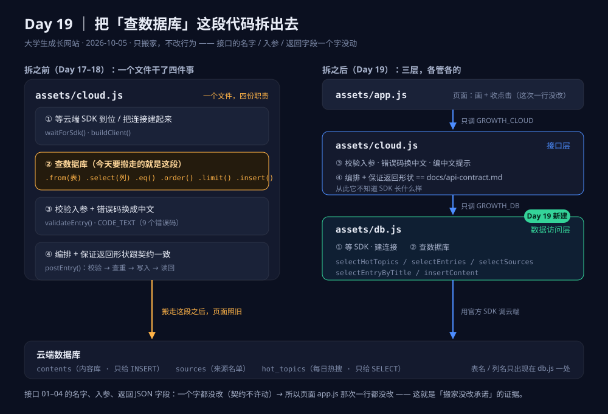

# day19-layering.md —— Day 19：把「查数据库」这段代码拆出去

> **这一天只做一件事：搬家。**
> 不新增功能、不改接口的名字和字段 —— 只把 `assets/cloud.js` 里那段
> 「跟数据库说话」的代码，整段搬到新建的 `assets/db.js`。
> 日期：**2026-10-05**（打卡 Day 19，第 3 周）。

---

## 一、今日一问的答案：那段代码从哪儿搬到了哪儿？

**问**：拆完之后，「查数据库」这段代码从哪移到了哪？

**答**：**从 `assets/cloud.js` 移到了新建的 `assets/db.js`。**

具体搬走的是这五样（原来都在 `cloud.js` 里）：

| 搬走的 | 原位置 | 新位置 |
| --- | --- | --- |
| `waitForSdk()` —— 等云端 SDK 到位 | `cloud.js` | **`db.js`** |
| `buildClient()` ＋ `client` 单例 —— 建连接 | `cloud.js` | **`db.js`** |
| 读热搜那条查询（`.from('hot_topics')…`） | `cloud.js` 的 `fetchHotTopics()` 内 | **`db.js`** 的 `selectHotTopics()` |
| 读来源那条查询（`.from('sources')…`） | `cloud.js` 的 `fetchSources()` 内 | **`db.js`** 的 `selectSources()` |
| 读三列那条查询（`.from('contents')…sources(…)`） | `cloud.js` 的 `fetchEntries()` 内 | **`db.js`** 的 `selectEntries()` |
| 查重那条查询（`.eq('source_id')…eq('title')`） | `cloud.js` 的 `postEntry()` 内 | **`db.js`** 的 `selectEntryByTitle()` |
| 写入那段（`.insert(row).select()` ＋「空数组＝没写成」的判断） | `cloud.js` 的 `insertEntry()` | **`db.js`** 的 `insertContent()` |

**留在 `cloud.js` 的是**：`validateEntry()`（校验）、`CODE_TEXT`（中文提示）、
`makeEntryId()`（生成主键）、`postEntry()`（编排）、三个 `fetch*()`（把 db.js 取回的数据
判空 / 判成败、换成契约要的形状）、`localDate()`。

**一句话记法**：
> **表名、列名、排序、条数 —— 这些「数据库语言」只在 `db.js` 出现；
> 校验、中文说法、契约形状 —— 这些「我们的规矩」只在 `cloud.js` 出现。**

---

## 二、为什么这么拆（分层思路）

### 2.1 拆之前的毛病

`cloud.js` 一个文件同时干四件事：连 SDK、查数据库、校验、编中文提示。
平时不出错，但它有两个必然会疼的地方：

1. **想改「从哪取数」时，得在一堆校验和文案里找那几行真正的查询**；
2. **两类东西混淆的代价不一样** ——「查哪张表」是数据库的事，
   「标题最多 60 字」是我们的产品规矩。它们混在一个文件里，
   改一边很容易顺手碰坏另一边，而**碰坏了不一定马上看得见**。

### 2.2 拆成三层

```
页面 app.js            画 + 收点击（这一次一行没改）
  ↓ 只调 GROWTH_CLOUD 那 4 个函数
接口层 cloud.js        校验入参 / 编中文提示 / 编排 / 保证返回形状 == 契约
  ↓ 只调 GROWTH_DB 那 5 个函数
数据访问层 db.js       等 SDK / 建连接 / 查什么表取哪些列 / 写一行
  ↓
云端数据库
```



### 2.3 「数据访问层」给自己定了三条规矩

写在 `db.js` 的文件头，以后改它先看这三条：

1. **只说话，不做判断** —— 它只回答「数据取回来没有」，
   不判「标题该不该 60 字以内」，不编任何中文句子。
   （所以它返回的失败形状里**没有 `message` 字段**。这一条是回归测试里专门查过的。）
2. **失败也走 resolve** —— 统一收成 `{ ok:false, reason }`，上层不用写 try/catch。
3. **返回数据库原本的样子** —— 不格式化、不挑字段、不含「这个项目自己的说法」。

### 2.4 两侧的「词表」是分开的（这是分层的关键）

| 这一层说什么 | 取值 | 谁翻译 |
| --- | --- | --- |
| `db.js` 的失败词表 | `no-sdk` / `no-client` / `query-failed` / `write-rejected` / `empty-result` | ↓ |
| `cloud.js` 的失败词表 | 读：`no-sdk` / `no-client` / `query-failed` / `empty`；写：9 个 `code` ＋ 中文 `message` | `cloud.js` 里的 `entryWriteFail()` 一处翻译 |

⚠️ 特别处理的一条：数据库原始错误码 **`23505`（唯一约束）在 `db.js` 里原样带出来、
不翻译**，由 `cloud.js` 翻成契约里的 `DUPLICATE`。
理由：「23505 该说成什么」是这个项目的说法，不是数据库的说法 —— 翻译只该发生在一处。

---

## 三、改了哪些文件

| 文件 | 改了什么 | 属于哪天 |
| --- | --- | --- |
| `assets/db.js` | **新建**（数据访问层，5 个函数） | **Day 19** |
| `assets/cloud.js` | 瘦身：只留校验 / 中文提示 / 编排 / 契约形状（搬走了约 100 行） | **Day 19**（原建于 Day 17，Day 18 扩过写） |
| `index.html` | `config.js` 与 `cloud.js` 之间插上 `db.js` 的 `<script>`；注释写明两层各管什么 | **Day 19** |
| `AGENTS.md` | 第 4 条的文件分工表 / 加载顺序 / 文件数 | Day 19 修正（v1.3） |
| `docs/api-contract.md` | 第一节加「三层结构」图 ＋ 补 04 号接口；第四节「落在哪」表重写 | Day 19 修正（**契约本身一个字没动**） |
| `docs/day19-layering.md` | **新建**（本文件） | **Day 19** |
| `docs/day19-layering.svg` | **新建**：分层示意图（余力加练） | **Day 19** |
| `docs/CHANGELOG.md` | 加 Day 19 一段 | **Day 19** |
| `README.md` | 文件结构树 ＋ 加载顺序 ＋ 「现在做到哪一步」 | Day 19 修正 |

⚠️ **`assets/app.js` 一个字都没改** —— 这正是「拆得对不对」的判据。
页面只认 `GROWTH_CLOUD` 那几个函数，底下换了一层实现，它根本不知道。

---

## 四、回归记录（**全接口回归**，不是「应该能行」）

### 4.1 逻辑层：命令行跑了 73 项，全过

脚本：当天工作区 `.tmp/day19/day19-api-test.mjs`（不联网，用一个假数据库打）
跑法：`node .tmp/day19/day19-api-test.mjs`

它覆盖的是**契约里写过的每一种情况**：

| 组 | 覆盖了什么 | 结果 |
| --- | --- | --- |
| A · db.js | 表名 / 列名 / 排序 / 条数上限；`kind='entry'` 过滤；一次带出关联来源；只取 id 的查重查询；数据库报错 → `query-failed`；**空数组算读成功**；写成功带回整行；`23505` 原样带出；**空数组 → `empty-result`（不假装成功）**；建连接失败 → `no-client`；SDK 一直不来 → `no-sdk`（真等了 6 秒） | 30 / 30 |
| B · cloud.js | 6 个导出名字一个不多一个不少；**9 个错误码的中文跟 `api-contract.md` 逐字对照**；校验的边界（60 字过 / 61 字不过、只空格算空、形态没填落默认、认不出的形态报错、前后空格 trim）；热搜取「最新那一天」；`?hot=N` 限条数；空 → `empty`；**查重命中不再写入**；**查重自己坏了不误判**（照样去写，靠 23505 兜底）；写入成功时字段跟契约 2.3 完全一致；**写进去的那行不带 `created_at`**（让数据库填默认值）；摘要空存 `null` | 43 / 43 |

**通过 73 条，失败 0 条。**

### 4.2 真机：本地开浏览器跑了 35 项，全过

脚本：`.tmp/day19/verify-day19-online.mjs local`（真开 Edge、真打云端、真点界面）

| 组 | 关键结论 |
| --- | --- |
| 加载顺序 | `window.GROWTH_DB` 存在、`GROWTH_CLOUD` 那 6 个名字一个没变 —— **顺序反了 `cloud.js` 会整体不执行，这一条是查它的** |
| 读接口 | 01 热搜 `ok:true`（8 条、带榜单日期）；02 三列 `ok:true`、13 条、**关联来源带回来了**、字段形状跟契约一致；03 来源 18 条、每行 4 个字段 |
| 页面 vs 接口 | 三列画出来了；**页面上的条目数（13）＝ 接口返回的 `total`（13）**；来源下拉 19 个选项 ＝ 18 ＋ 1 个占位 |
| 写接口 | 真写入 `{ok:true, id:"u-2026-10-05-…"}`，字段跟契约 2.3 一致；重复提交 → `DUPLICATE` ＋ 中文提示；空标题 → `MISSING_TITLE`（**没发网络请求**）；写完立刻再读，**条数 +1 且新那条真的在里面** |
| 断网 | 第 2 秒起进入「没读出来 + 重试」状态：**不白屏、不编内容顶上、JS 报错 0 条**；网络恢复后自己就好了 |
| 全程 | **JS 报错 0 条** |

**通过 35 条，失败 0 条。**

### 4.3 线上：发布之后对着正式域名再跑一遍

脚本：`.tmp/day19/verify-day19-online.mjs live`
目标：`https://source-board.app.workbuddy.host/`（发布 `verified: true` 之后）

**通过 35 条，失败 0 条。** 线上跑出来的实际数字：

| 项 | 线上实测 |
| --- | --- |
| `window.GROWTH_DB` / `GROWTH_CLOUD` | 两个都在，6 个导出名没变 |
| 01 读热搜 | `{ok:true, n:8, date:"2026-10-03", total:30}` |
| 02 读三列 | `{ok:true, total:14}`（含 `sources` 子对象，12 个字段跟契约一致） |
| 03 读来源 | `{ok:true, n:18}` |
| 页面 vs 接口 | 页面上画了 **14** 条 ＝ 接口 `total` **14**；来源下拉 19 个选项 |
| 写入（真写） | `{ok:true, id:"u-2026-10-05-6pm", …}` → 再读 **14 → 15**，新那条在里面 |
| 重复提交 | `{ok:false, code:"DUPLICATE", message:"这条内容已经在库里了…"}` |
| 空标题 | `MISSING_TITLE`，中文提示「标题不能为空」，**没发网络请求** |
| 断网 | 进入「内容没读出来 + 重试」，条目 0 条（**没编内容**），**JS 报错 0 条** |
| 网络恢复 | 读接口自己就好了 |

**测试数据的清理**（重要，别在库里留垃圾）：
今天一共真写进去 **4 条**测试内容（本地 2 条 ＋ 线上 2 条，其中 1 条是给截图用的），
全部按标题前缀 `Day 19 拆层回归` 用 SQL 删干净 ——
删后回查：`contents` 表 **21 行 / `kind='entry'` 13 条 / 残留 0 条**，跟今天开工时一模一样。

**两张交付截图**（在当天工作区 `.tmp/day19/`，不进 git）：
- `day19-1-文件结构.png` —— 带地址栏；图里是**真实命令输出**（`git status --short`、
  `ls -l assets/*.js`、`wc -l`、`node --check`），能看见 **`?? assets/db.js`**（新文件）
  和 `assets/db.js  Oct 5 21:06`、`280 db.js`。
- `day19-2-线上接口返回.png` —— 带地址栏（`https://source-board.app.workbuddy.host/#/library`）；
  图里是页面上那张表单**真提交一次**之后原样显示的返回 JSON
  （`{"ok":true,"id":"u-2026-10-05-fri",…}`）。

---

## 五、这一天踩的坑（写下来，下次不重复）

**① 断言不能凭想象写。** 第一次跑真机回归，4 条「失败」里有 3 条是**我断言写错了**，产品是好的：

| 我猜的 | 实际 | 真相 |
| --- | --- | --- |
| `document.title === '大学生成长网站'` | `'内容库 · 大学生成长网站'` | 标题是**按视图变的** |
| 页面上 `.entry` 的条数 ＝ 接口的 `total` | 页面 15 / 接口 13 | 页面上还有一块「四种状态对照」的**开发演示区**，它也会画 `.entry`。要**只数 `#library-list` 里的** |
| 断网 6 秒后应当已经报错 | 还在「正在读取内容…」 | 实测要 **~8 秒**才切到错误态 |

**→ 做法：新写的断言第一次跑一定失败，所以先把实际值打出来，再照着实际值写断言。**

**② 两次跑之间，测试数据会互相干扰。** 第一次跑写进去了一条测试内容，
第二次跑的第一条断言就成了 `DUPLICATE`。改法：测试标题带上时间戳（每次都是新的），
跑完再用 SQL 按前缀清理。

**③ 页面停住 ≠ 页面坏了。** 断网时页面有 8 秒钟显示骨架屏。
那 8 秒里「页面没反应」，但它是**在等 SDK 自己的超时** —— 这不是 bug，
是「宁可慢一点，也要等出个真结果」。别把「正在加载」当成「卡死」。

---

## 六、这一天刻意**没**做的事（说清楚，免得以为是漏了）

- **接口路径和字段名一个没动**（清单里明说「契约不许动」）：`GROWTH_CLOUD` 那 6 个名字、
  四条接口的入参、返回的 JSON 字段、9 个错误码的中文，全部原样。
- **没加新功能**、没碰 `app.js`、没碰数据库结构、没碰任何权限。
- **没改 `store.js`**（本地那只抽屉）—— 它原来就是「一个文件管一件事」的模板，
  这次是让 `cloud.js` 向它看齐。

---

## 七、下一步可以做什么

1. **推送**（由 Jimmy 在本机跑，见当天收尾）。
2. Day 20 候选：清单原话是 **PATCH / DELETE** —— 但要不要做、给谁用，
   仍然卡在 `PRD.md` 8.2 待定项 13/15（要不要第二个使用者、要不要登录）。
3. 还没定的事（都在 `PRD.md` 8.2）：榜单要不要改读云端（14，Day 18 已做）、
   第二使用者要不要来（15）、演示区要不要删（16）。
